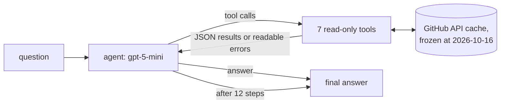

# repo-history-agent

An agent that answers "is this fixed?", "why is it like this?" and "what happened before?" about a real codebase, [`langchain-ai/langgraph`](https://github.com/langchain-ai/langgraph), by walking its pull requests, issues, reviews, code changes and releases.
It is measured against a hand-built test set of 16 cases on a snapshot of the repository frozen at 2026-10-16 18:34 UTC.

## A sample run

Question (case `recursion-limit-default`, run `f546e36a3aea`, prompt v5.4, gpt-5-mini):

> my graph used to stop with a recursion limit error after 25 steps but now long runs just keep going. did the default recursion limit change? what is it now and why?

The trap: PR #6676's description says it raises the default "to 1000". Its review suggestion and its code say 10000. A later PR, #7355, moved it to 10007.

Tool calls, in order:

```
 1 search("recursion limit")             11 get_pr(7334)
 2 search("recursion_limit default")     12 version_for_pr(6676)
 3 search("default recursion limit")     13 get_timeline(6676)
 4 get_pr(7326)                          14 version_for_pr(7355)
 5 get_pr(7322)                          15 get_timeline(7355)
 6 get_issue(7313)                       16 get_issue(5883)
 7 get_issue(7314)                       17 get_issue(9163)
 8 search("DEFAULT_RECURSION_LIMIT")     18 get_pr(9298)
 9 get_pr(7355)                          19 get_pr(6733)
10 get_pr(6676)
```

Final answer, quoted in part ([...] marks cuts):

> It used to be 25; it was changed to 10000 (PR #6676, released in langgraph 1.0.6) and then the codebase adjusted the fallback value to 10007 (PR #7355, released in langgraph 1.1.4). [...]
>
> The PR message explicitly said: "25 is pretty unreasonable for most applications, bumping up to 1000 by default, burden really should be on the user..." and the code was changed to 10000 (get_pr #6676, version_for_pr #6676).
>
> Instead of merging the sentinel PRs, the project landed PR #7355 (merged, included in langgraph 1.1.4) which changed the fallback literal from 10000 to 10007 (get_pr #7355, version_for_pr #7355).

All three runs of this case passed on that commit. With the same prompt, before `get_pr` showed review comments and code, the case passed 1 of 3 runs (2026-10-27).

## How it works



The agent is a hand-built LangGraph `StateGraph`: a model node and a tool node in a loop, plus a node that forces the final answer. The model decides which tool to call next, reads the result, and repeats. After 12 steps it must answer with what it has. Finding a fix often means going from an issue to a PR, then to a later issue that reports a regression.

The 7 tools, all read-only GitHub calls scoped to the one repository:

| Tool | Returns |
|---|---|
| `search` | Matching issues and PRs with dates, merge state and the passage that matched. Options for PRs only, merged only, date ranges and oldest first. Adds a note when a search returns almost nothing or repeats an earlier one |
| `get_pr` | A PR's description, state, merge date, the author's role, its first review comments, and up to 40 changed lines of code |
| `get_issue` | An issue's text, state, close reason and the author's role |
| `get_comments` | The discussion and code-review comments on an issue or PR, each with its author's role |
| `get_timeline` | Everything that later referenced the item, and its merge, close and review events |
| `version_for_pr` | The releases whose notes list the PR, flagging a PR that was reverted in the same release |
| `file_history` | The PRs that changed one source file, oldest first. Takes a path or a code name such as a class |

An author's role is `maintainer`, `contributor` (with their number of merged PRs), `outside user` or `bot`. It lets the agent tell a project decision from a stranger's opinion.

**The frozen snapshot.** Every tool answers as the repository stood at 2026-10-16 18:34 UTC. Items created later do not exist. Later merges, comments, timeline events and releases are hidden. Every API response is cached on disk, so a re-run sees the same data, and a saved answer can be re-graded against exactly what the agent saw. `harness/check_freeze.py` runs 25 checks on real items from both sides of the cutoff.

**Errors are visible.** A missing item or a rate limit comes back as a readable message, such as `pr 9999 does not exist in langchain-ai/langgraph`, never as an empty result. An empty result would look like "nothing was found" and lead to a confident wrong answer.

## Why no embeddings

The answers are spread across several items: a PR, an issue filed months later, a review comment. No single chunk holds the answer, so similarity search over chunks does not fit. Before building the agent, keyword search was tested on the first question: with 3 or 4 keywords the target PR was in the top 5 results, or one hop away, for every phrasing tried. A full sentence returned 2 results and missed it, because GitHub search requires every word to match. The problem was query wording, which is agent behavior that the eval can measure.

## Evaluation

Each case in `evals/golden.yaml` is a real question with an answer verified by hand against the repository, including review comments and git history. A case can require:

- **citations**: PR or issue numbers the answer must cite;
- **tool calls**: tools that must be called, including specific items that must be opened (`get_pr:7355`);
- **facts**: words or versions the answer must state;
- **traps** (`should_not`): patterns for plausible false claims that fail the answer.

The case from the sample run, with its second trap shortened here:

```yaml
- id: recursion-limit-default
  type: evolution
  q: "my graph used to stop with a recursion limit error after 25 steps but now long
      runs just keep going. did the default recursion limit change? what is it now and why?"
  expect_tools_called: [search, "get_pr:6676", "get_pr:7355"]
  expect_cites: [6676, 7355]
  must_mention: ["10007"]
  should_not:
    - "(recursion[_ ]limit|default)\\W+(is|remains)\\W+(still\\W+)?25\\b"
    - <the default is 1000, unless the sentence says the description was contradicted>
```

**Pass rule.** A run passes only if every assertion holds. There is no partial credit. Each case runs 3 times, and results are reported as passed runs out of total runs.

**Where a failure happened.** For each required item the harness replays every tool call and reports whether the item was surfaced by a search, opened, and cited. For each required fact it reports whether the fact was in the agent's context and whether the answer said it. Example from the Nov 1 run of the react case: the PR holding the reason was surfaced in 3 of 3 runs, opened in 2 and cited in 1. The key word was in context in 3 of 3 runs and said in none. The evidence reached the agent and was not used, so the fix is not in retrieval.

**Checking the grader.** The grader is deterministic: citation sets, tool-call matching and regular expressions, with no LLM judge. Regular expressions can misgrade, so the grader has its own test. `evals/grading_examples.yaml` holds 116 right and wrong answers, with wrong answers written to break one rule at a time where possible, and `harness/check_grading.py` fails if any is graded the wrong way. After every grading change, all saved runs are re-graded and every changed verdict is read. Reading rule hits and changed verdicts caught:

- banned phrases counted when the agent quoted or negated them ("There is no direct PR or issue I saw that says 'ToolNode is deprecated'");
- a rule that failed correct answers ("A related bug was fixed in 1.2.15, but not yours"), now removed;
- correct refusals the patterns missed ("I could not retrieve an authoritative historical rationale"), now accepted;
- a false pass: an answer told a langgraph.js user to upgrade to a Python release, and passed until the rule was fixed.

Across 489 saved runs, no answer cites a PR or issue number that did not appear in a tool result.

## Results

**All 16 cases, v5.6: 35/48 runs passed** (Nov 13).

gpt-5-mini, medium reasoning, 3 runs per case. Scores are re-graded with the current grader. Every saved run (32 results files, 489 runs) is listed in [`results/summary.md`](results/summary.md).

| Date (2026) | Change | Cases x runs | Passed | Median tokens (in + out) | Median seconds | Median tool calls |
|---|---|---|---|---|---|---|
| Oct 8 | prompt v5.2, original 10 cases | 10 x 3 | 17/30 | 57,543 | 51 | 14 |
| Oct 18 | same prompt; search shows snippets and merge state, versions flag same-release reverts | 10 x 3 | **23/30** | 45,994 | 63 | 14 |

Targeted runs on single cases, after harder cases were added and the repository was frozen:

| Case | Before | After | Change |
|---|---|---|---|
| recursion-limit-default | 1/3 (Oct 27) | 2/3, then 3/3 (Oct 29) | `get_pr` shows review comments (`dff3357`), then code changes (`d50d7a7`) |
| checkpoint-serialization-history | 0/3 (Oct 29) | 2/3 (Oct 30) | `file_history` tool and prompt v5.5 (`7239ad9`, `64ffc21`) |
| postgres-driver-why | 1/3 (Oct 29) | 3/3 (Nov 1) | author roles and prompt v5.6 (`8a3f91a`, `11abecf`) |

What moved the results:

- **What the tools show decides what the agent concludes.** With the same prompt (v5.2), adding a snippet and the merge state to search results and flagging same-release reverts took the original set from 17/30 to 23/30.
- **Stronger evidence beat instructions.** On the recursion case, a prompt rule ("when sources disagree, prefer the latest change", v5.3) did not help. Showing the review comment took it to 2/3 and showing the code took it to 3/3.
- **Some answers need history that search ranks low.** The serialization case needs a 2024 PR whose text shares few words with the question. `file_history` reaches it from a class name the agent already searches for.

Still failing:

- **Step budget.** Evolution and "why" cases can hit the 12-step limit before the agent checks timelines and releases.

## Limitations

- One repository, 16 cases, one model family (gpt-5-mini, plus gpt-5.1 in the first runs), 3 runs per case. A one-run difference on a case is within noise.
- Most cases are in core `libs/langgraph`. Three cover the checkpointer packages and the Python SDK. The CLI has no case.
- The grader is rule-based (regular expressions), with no LLM grader stage yet.

## Run it

Python 3.11.

```bash
pip install -r requirements.txt
cp .env.example .env   # then fill in GITHUB_TOKEN and OPENAI_API_KEY
```

The API cache is not in the repository, so the first run fetches from GitHub. The freeze is applied in code, so fetched data is still filtered to 2026-10-16 18:34 UTC.

Ask one question (latest prompt, medium reasoning):

```bash
MODEL=gpt-5-mini python -m agent.graph "has the default recursion limit changed?"
```

Run the eval and print the report:

```bash
MODEL=gpt-5-mini python -m harness.score --repeat 3 --prompt v5.6 --reasoning medium              # all 16 cases
MODEL=gpt-5-mini python -m harness.score recursion-limit-default --repeat 3 --prompt v5.6 --reasoning medium
python -m harness.score --rescore data/results/<file>.json   # re-grade saved answers, no model calls
python -m harness.check_grading                              # grader self-test
python -m harness.check_freeze                               # freeze self-test
python -m harness.summary > results/summary.md               # rebuild the results table
```

Re-grading and the summary read saved runs from `data/`, which is not in the repository. The harness also checks a daily token budget; `--allow-paid` skips that check.

## Repo layout

```
agent/     the LangGraph agent, prompt versions v0 to v5.6, tool wrappers and tracing
ingest/    GitHub client: cached requests, the freeze, and the tool implementations
harness/   scoring, the grader and freeze self-tests, and the results summary
evals/     golden.yaml (16 cases) and grading_examples.yaml (116 graded answers)
results/   summary.md, the re-graded table of every saved run
data/      git-ignored: API cache, traces and raw results
```
